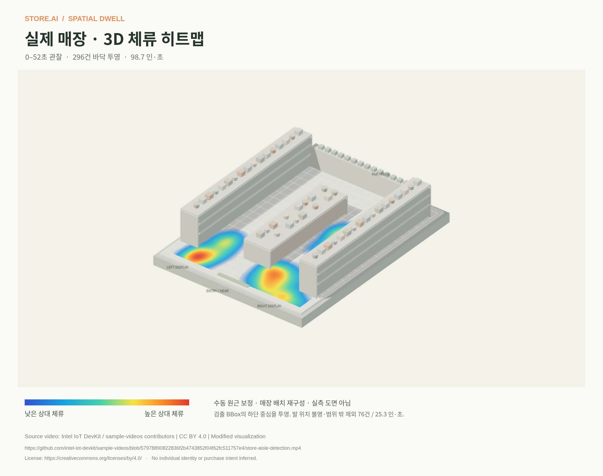

# tracker.ai

**Turn real store movement into traceable spatial observations.**

A prototype pipeline from CCTV footage to person detection, temporary tracks, observation records, floor projection, and a 3D dwell map. Explore actual housewares-store footage, inspect BBoxes and movement trails, and see how observations accumulate over time.

## Background and vision

Retail businesses in many advanced economies face pressure from **labor costs**. For owner-operated stores in South Korea, hiring additional staff can be a significant financial commitment. Keeping teams small, however, can leave a few employees handling many tasks and unpredictable peaks in demand.

**Heavy workloads** can contribute to **turnover**, placing further pressure on the remaining team. Without reliable information about customer demand and how work is distributed throughout the day, owners may find it difficult to determine when additional staffing would make the greatest difference.

tracker.ai was developed to help close this information gap. Its **long-term goal** is to combine video-derived observations—such as customer traffic, staff movement, and task flow—with POS transactions, sales, and other store data through **multimodal analysis**. The aim is to support **hourly staffing recommendations** and **operational reports** that help balance workloads, improve service, and identify opportunities for **revenue growth**.

**Current stage:** The prototype currently focuses on collecting **person tracks** and visualizing movement and dwell patterns as **heatmaps**. POS integration, staff-specific workflow analysis, staffing recommendations, and business reporting remain **planned capabilities**.

[Project site deployment target](https://ikjoo5.github.io/tracker.ai/) · [Pipeline documentation](docs/pipeline.md) · [Deployment guide](docs/deployment.md)



## What is included?

| Component | Purpose |
| --- | --- |
| Project website | Pipeline explanation, real examples, accumulation diagrams, and a demo video |
| Actual observations | Pretrained MobileNet-SSD person BBoxes, temporary IDs, coordinates, and sample durations |
| 3D dwell map | Relative observation time projected onto a manually calibrated floor |
| Data exports | Frame-level CSV/JSON, projected coordinates, density grids, PNGs, and MP4s |
| Local analysis workspace | Video upload, zone configuration, CPU inference, and result generation |

The website’s crowded BBox scenario and expanded-store heatmap are **illustrative concepts**, clearly separated from actual inference results. The layout used for the measured 3D example is also a manual reconstruction, not a surveyed floor plan or an automatic 3D reconstruction.

## Actual demo results

The default demo uses Intel’s publicly released footage of a **real housewares store**. The original 00:08–01:00 segment is presented as a silent, 52-second, 15 fps excerpt.

| Observation | Result |
| --- | ---: |
| Clip duration / sampled frames | 52 seconds / 156 |
| Person detection observations | 372 |
| Peak simultaneous detections | 5 |
| Floor-projected / excluded observations | 296 / 76 |
| Observation time included on the floor | 98.665 person-seconds |

The tracker produced 18 temporary IDs, including fragments caused by occlusion. **That does not mean 18 visitors.** The floor map excludes 59 observations with cropped feet and 17 outside the calibrated floor.

- [BBox and movement-trail video](public/showcase/demo-bbox.mp4)
- [3D dwell heatmap PNG](public/showcase/dwell-3d.png)
- [Observation CSV](public/showcase/detections.csv) · [Full analysis JSON](artifacts/store-ai-real-analysis.json)
- [Projected floor coordinates](artifacts/store-ai-floor-points.csv) · [Grid and calibration metadata](artifacts/store-ai-floor-heatmap.json)

## Local development

Requirements: Python 3.12, Node.js 22.12 or newer, npm, and FFmpeg.

```bash
git clone https://github.com/ikjoo5/tracker.ai.git
cd tracker.ai
bash scripts/setup.sh
bash scripts/dev.sh
```

The development frontend uses port 5173 and FastAPI uses port 8000. Open the **analysis workspace** from the project page to use the local analysis tools. In an existing isolated cloud task, use the supplied checkout; a separate Git worktree is unnecessary.

GitHub Pages hosts the introduction and a **read-only workspace with previously collected public observations**. It does not run server inference or accept new video uploads. Use the local API to analyze your own footage.

```bash
# Collect coordinates and observation times from your own video, then render MP4s
.venv/bin/python scripts/collect.py /path/to/store.mp4 --output artifacts/my-store

# Reproduce analysis outputs for the actual public sample
.venv/bin/python scripts/render_retail_demo.py

# Export projected floor coordinates and the time-weighted grid
npm run export:floor
```

Uploads are limited to 100 MB and 120 seconds. Use `--no-render` to collect data only, or `--zones zones.json` to configure observation zones. A different camera needs its own floor calibration before its observations can be shown in 3D.

The `store-ai-*` artifact filenames remain for compatibility; the project and interface are branded **tracker.ai**.

## Project structure

```text
src/Landing.tsx                Static project introduction
src/App.tsx                    Analysis workspace
src/FloorHeatmap.tsx           Three.js store graphic and PNG export
src/floorProjection.ts         Manual homography and time-weighted grid
server/analysis.py             Frame sampling, detection, tracking, aggregation
server/detector.py             Pretrained MobileNet-SSD CPU inference
server/exports.py              Raw observation CSV
server/render.py               BBox and movement-trail MP4s
scripts/prepare_retail_demo.py Verified public excerpt and attribution
scripts/setup_model.py         Pinned model revision and SHA-256 verification
public/showcase/               Public website images, videos, and data
docs/pipeline.md               Processing stages, data dictionary, limitations
```

## Validation

```bash
.venv/bin/python -m unittest discover -s tests -v
npm run test:floor
npm run build
```

The existing validation includes 24 backend tests and 14 floor-projection cases. Browser checks and their scope are documented in the [validation record](docs/validation.md). Passing these checks does not establish detector accuracy or real-world dwell-time error.

## Source and interpretation

Footage: [Intel IoT DevKit / sample-videos — store-aisle-detection.mp4](https://github.com/intel-iot-devkit/sample-videos/blob/57978890822836f2b4743852f04f62fc511757e4/store-aisle-detection.mp4). Terms: [CC BY 4.0](https://creativecommons.org/licenses/by/4.0/) · [License copy](docs/licenses/intel-sample-videos-CC-BY-4.0.txt). The video and data retain attribution and describe the excerpt, frame-rate conversion, audio removal, and added analysis overlays. No endorsement or affiliation is implied.

The detector uses the pretrained person class from [MobileNet-SSD](https://github.com/chuanqi305/MobileNet-SSD). No new training, retail-specific fine-tuning, or face recognition has been performed. Missed detections, occlusion, and temporary-ID changes remain. The prototype does not determine identity, purchase intent, employee performance, or staffing requirements.

Local uploads and results are stored under `server/data/uploads/`, `server/data/results/`, and `server/data/media/`, which Git excludes. The public website contains only the reusable public sample and its derived results.
