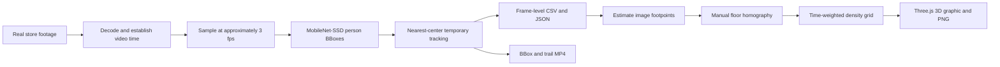

# From video to spatial observations

tracker.ai implements a traceable **observation collection pipeline** for real footage. It does not infer purchases, employee productivity, or required staffing levels.



## 1. Prepare actual store footage

[`prepare_retail_demo.py`](../scripts/prepare_retail_demo.py) downloads Intel IoT DevKit’s `store-aisle-detection.mp4` at a pinned revision and verifies its SHA-256. It converts original time 00:08–01:00 to a silent, 52-second, 15 fps H.264 excerpt.

This is a **housewares store**, not a grocery aisle. [`demo-retail.json`](../server/data/demo-retail.json) records the source, CC BY 4.0 terms, and modifications. If the actual default footage is missing, the API returns a preparation error rather than silently switching to synthetic footage.

```bash
.venv/bin/python scripts/prepare_retail_demo.py
```

## 2. Sample video time and detect people

[`analysis.py`](../server/analysis.py) computes video time from the original frame index and frame rate, then selects approximately three observations per second. `sample_seconds` is the interval until the next actual sample, with the final interval capped at the end of the clip. Low-frame-rate inputs and frame rates not divisible by three retain their actual intervals.

[`detector.py`](../server/detector.py) runs pretrained MobileNet-SSD through OpenCV DNN on the CPU.

- Input: a 300×300 blob with the model’s prescribed scaling and mean.
- Class: VOC person, class ID 15.
- Minimum model score: 0.40.
- Non-maximum suppression threshold: 0.40.
- Output: normalized BBoxes and model scores relative to the source dimensions.

The model revision is `bb17b6c3eef36d80be441ae8e5339be66e8e3b7a`. [`setup_model.py`](../scripts/setup_model.py) preserves TLS verification and checks the declared SHA-256 values. Model files are reproduced during installation rather than committed to Git. A model score is not a calibrated accuracy guarantee.

## 3. Assign temporary tracks and zones

The baseline tracker connects BBox centers across adjacent observations and assigns temporary IDs such as `T001`. It considers tracks seen within the previous two seconds and links a candidate when the distance is below 0.14 in normalized image coordinates.

An ID is not an identity. Occlusion, crossings, and re-entry can split one person into multiple IDs. The default result’s 18 IDs must not be interpreted as 18 visitors.

Zones are normalized rectangles in image space. A detection is assigned to the first zone containing its BBox center; list order resolves overlaps. The actual sample uses labels for the left display, rear aisle, front center, and right display. Zone `person_seconds` sums observed people multiplied by their sample durations.

## 4. Save observation records

[`exports.py`](../server/exports.py) writes one CSV row per detection. JSON also retains source metadata, zones, frames, tracks, aggregate observations, and attribution.

| Field | Unit or meaning |
| --- | --- |
| `analysis_id` | Identifier for the analysis job |
| `source_name`, `source_kind` | Source name and public-footage/upload/synthetic classification |
| `source_url`, `source_license` | Public source and reuse terms |
| `detector` | Detection method |
| `frame_index` | Zero-based frame index in the analyzed input |
| `time_seconds` | Seconds since the beginning of the excerpt |
| `track_id` | Temporary tracking ID within this video |
| `role` | `person` for actual footage; no automatic employee/customer classification |
| `zone` | First matching zone ID, or `other` |
| `bbox_x`, `bbox_y` | Top-left corner, normalized to 0–1 |
| `bbox_width`, `bbox_height` | Width and height, normalized to 0–1 |
| `bbox_*_px` | Pixel coordinates using `source.width` and `source.height` |
| `confidence` | Model score, not a guarantee of accuracy |
| `sample_seconds` | Observation-time weight for this sample |

For the default excerpt, `time_seconds=0` corresponds to original time 00:08. The offset is retained as `source.provenance.original_start_seconds`.

```bash
.venv/bin/python scripts/collect.py /path/to/store.mp4 --output artifacts/my-store
# Raw records only: --no-render
# Custom observation zones: --zones zones.json
```

## 5. Project estimated feet onto the floor

The 3D map uses a different reference from the earlier video heatmap. The earlier heatmap accumulated image-space BBox centers. The 3D map estimates a footpoint at each BBox’s bottom center and applies a manual four-corner homography.

The default calibration in [`floorProjection.ts`](../src/floorProjection.ts) is specific to the Intel sample.

```text
Image: (0.28,0.24), (0.61,0.24), (0.90,1.00), (0.00,1.00)
Floor: (0,0),       (1,0),       (1,1),       (0,1)
```

Floor coordinates `u,v` are unitless values in the range 0–1. The far edge is `v=0`; the edge near the camera is `v=1`. These are not calibrated metres or square metres.

A BBox bottom at `y≥0.995` is treated as cropped, so its footpoint is excluded. Points outside the calibrated floor are also excluded instead of being clamped to the boundary and creating artificial edge hotspots. This calibration is not automatically applied to another camera.

## 6. Accumulate observation time in a grid

Only the overlap between a sample’s actual `sample_seconds` and the selected time interval contributes. Gaussian weights distribute each projected observation spatially, with normalization that preserves the sum of mapped person-seconds.

The current 3D view uses a 128×160 grid and normalized `sigma=0.04`. Color represents relative dwell within the selected interval, not physical person density or temperature. The interval’s maximum can change, so compare the accompanying values when comparing time ranges. The accumulation illustration uses the same full-clip color scale across its 13-, 26-, and 52-second prefixes.

```bash
npm run export:floor
```

The resulting [`store-ai-floor-heatmap.json`](../artifacts/store-ai-floor-heatmap.json) and [`store-ai-floor-points.csv`](../artifacts/store-ai-floor-points.csv) retain source attribution, calibration, grid values, and included/excluded observation amounts. The older filenames remain for compatibility with existing scripts.

## 7. Present 3D graphics and explanatory concepts

[`FloorHeatmap.tsx`](../src/FloorHeatmap.tsx) reconstructs a schematic shelf layout with Three.js and draws the actual grid on its floor. It supports rotation, zoom, top view, shelf visibility, interval selection, and PNG export. A compatibility visualization is available when WebGL cannot be used.

Shelf shapes, heights, and spacing are illustrative rather than surveyed or automatically recovered. The public page separately labels its crowded BBox scene and expanded-store heatmap as **generated explanatory concepts**, not model inference or measured results.

## Reproduced results and validation scope

| Item | Actual default clip |
| --- | ---: |
| Input | 52 seconds, 720×404, 15 fps |
| Detection samples | 156 frames, 372 observations |
| Temporary IDs | 18 total, 16 observed at least twice |
| Peak simultaneous detections | 5 |
| Total observation weight | 123.996 person-seconds |
| Included in the 3D floor | 296 observations, 98.665 person-seconds |
| Excluded | 59 cropped feet + 17 outside the floor = 76 observations, 25.331 person-seconds |

The existing 24 backend tests and 14 floor-projection cases check timing, coordinates, record preservation, error handling, and weight conservation. Ground-truth detector precision/recall, ID continuity, and real dwell-time error have not been evaluated. See the [validation record](validation.md) for commands and boundaries.
