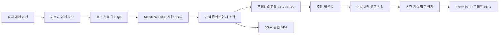

# 영상에서 공간 데이터까지

이 프로젝트는 실제 영상에서 **관찰값을 수집하는 흐름**을 구현합니다. 사람이 무엇을 구매했는지, 얼마나 효율적으로 일했는지, 매장의 적정 인력이 몇 명인지를 판정하는 모델은 포함하지 않습니다.



## 1. 실제 매장 영상 준비

[`prepare_retail_demo.py`](../scripts/prepare_retail_demo.py)는 Intel IoT DevKit의 `store-aisle-detection.mp4`를 고정 리비전에서 가져와 SHA-256을 확인합니다. 원본 00:08–01:00 구간을 52초·15fps H.264 영상으로 변환하고 음성을 제거합니다.

원본은 식품 마트가 아닌 **생활용품 매장**입니다. 출처·CC BY 4.0·변경 내역은 [`demo-retail.json`](../server/data/demo-retail.json)에 기록합니다. 기본 실제 영상이 없으면 API는 준비 오류를 반환하며 합성 영상으로 바꾸지 않습니다.

```bash
.venv/bin/python scripts/prepare_retail_demo.py
```

## 2. 영상 시각과 탐지

[`analysis.py`](../server/analysis.py)는 원본 프레임 번호와 fps로 영상 시각을 계산하고 약 3fps로 표본을 선택합니다. `sample_seconds`는 다음 실제 표본 시각과의 간격이며 마지막 표본은 영상 끝까지로 제한합니다. 저fps 또는 3으로 나누어떨어지지 않는 입력도 고정 1/3초로 덮어쓰지 않습니다.

[`detector.py`](../server/detector.py)는 OpenCV DNN의 CPU 경로로 사전학습 MobileNet-SSD를 실행합니다.

- 입력: 300×300 blob, 지정된 평균값과 스케일로 전처리
- 클래스: VOC person, class ID 15
- 최소 모델 점수: 0.40
- 중복 억제: NMS 임계값 0.40
- 출력: 원본 영상 기준 정규화 BBox와 모델 점수

모델 리비전은 `bb17b6c3eef36d80be441ae8e5339be66e8e3b7a`입니다. [`setup_model.py`](../scripts/setup_model.py)가 선언된 SHA-256과 TLS 검증을 유지하며 파일을 준비합니다. 모델 파일은 Git에 포함하지 않고 설치 시 재현합니다. 모델 점수는 보정된 정확도나 확률 보증이 아닙니다.

## 3. 익명 트랙과 구역

인접한 표본의 BBox 중심을 연결해 `T001` 같은 임시 ID를 부여합니다. 최근 2초 안에 관찰됐고 중심 거리가 정규화 좌표 0.14 미만인 후보를 연결하는 초기 기준 방식입니다.

이 ID는 사람의 신원이 아닙니다. 가림·교차·재등장 때문에 하나의 사람이 여러 ID로 분리될 수 있습니다. 기본 결과의 18개 ID를 18명의 방문자로 해석하면 안 됩니다.

구역은 영상 좌표의 정규화 사각형입니다. BBox 중심이 들어간 첫 번째 구역에 할당하며, 구역이 겹치면 목록 순서가 우선합니다. 기본 공개 영상의 라벨은 좌측 매대 앞·통로 안쪽·하단 중앙 구역·우측 매대 앞입니다. 구역별 `person_seconds`는 해당 구역에서 관찰한 인원×관찰시간의 합계입니다.

## 4. 관찰 데이터 저장

[`exports.py`](../server/exports.py)는 탐지 한 건을 CSV 한 행으로 저장합니다. JSON은 원본 메타데이터, 구역, 프레임, 트랙, 집계, 출처를 함께 보존합니다.

| 필드 | 단위·의미 |
| --- | --- |
| `analysis_id` | 해당 분석 작업 식별자 |
| `source_name`, `source_kind` | 원본 이름과 실제 공개·업로드·합성 구분 |
| `source_url`, `source_license` | 공개 원본 출처와 이용 조건 |
| `detector` | 사용한 탐지 방법 |
| `frame_index` | 분석한 원본의 0부터 시작하는 프레임 번호 |
| `time_seconds` | 발췌된 입력 영상 시작 기준 초 |
| `track_id` | 영상 내부의 임시 추적 ID |
| `role` | 실제 영상에서는 `person`; 직원·고객 자동 분류 없음 |
| `zone` | 처음 일치한 구역의 ID 또는 `other` |
| `bbox_x`, `bbox_y` | 왼쪽 위 모서리, 0–1 정규화 좌표 |
| `bbox_width`, `bbox_height` | 너비·높이, 0–1 정규화 값 |
| `bbox_*_px` | 결과의 `source.width`, `source.height` 기준 픽셀 값 |
| `confidence` | 모델 점수, 정확도 보증 아님 |
| `sample_seconds` | 해당 표본의 관찰시간 가중치 |

기본 영상의 `time_seconds=0`은 공개 원본의 8초에 해당합니다. 시각 기준은 `source.provenance.original_start_seconds`로 함께 기록합니다.

```bash
.venv/bin/python scripts/collect.py /path/to/store.mp4 --output artifacts/my-store
# 원시 데이터만: --no-render
# 구역 지정: --zones zones.json
```

## 5. 발 위치를 바닥으로 투영

새 3D 체류맵은 영상 히트맵과 기준이 다릅니다. 기존 2D 영상 히트맵은 BBox 중심을 영상 좌표에 누적합니다. 3D 체류맵은 BBox 아래쪽 중심을 발 위치로 추정하고, 수동 지정한 네 바닥 모서리로 원근 변환합니다.

[`floorProjection.ts`](../src/floorProjection.ts)의 기본 보정은 Intel 샘플 전용입니다.

```text
영상 좌표: (0.28,0.24), (0.61,0.24), (0.90,1.00), (0.00,1.00)
바닥 좌표: (0,0),       (1,0),       (1,1),       (0,1)
```

바닥의 `u,v`는 단위 없는 0–1 좌표입니다. 뒤쪽이 `v=0`, 카메라에 가까운 쪽이 `v=1`입니다. 미터나 제곱미터로 보정된 좌표가 아닙니다.

BBox 아래쪽이 영상 경계 `y≥0.995`에서 잘리면 발 위치가 불명확하므로 제외합니다. 변환 후 바닥 밖에 있는 좌표도 제외하며, 가장자리로 강제 이동시켜 가짜 고밀도 띠를 만들지 않습니다. 다른 카메라에는 이 보정을 자동 적용하지 않습니다.

## 6. 관찰시간을 격자로 누적

선택 시간 구간과 각 표본의 실제 `sample_seconds`가 겹치는 시간만 반영합니다. 각 투영 지점 주위에 가우시안 가중치를 분배하며 격자 합계가 투영된 인·초 합계와 일치하도록 정규화합니다.

현재 3D 화면은 128×160 격자와 정규화 폭 `sigma=0.04`를 사용합니다. 색상은 선택 구간 안에서 정규화한 상대 체류량입니다. 물리적 면적당 인원 밀도나 실제 온도가 아닙니다. 시간 구간마다 색상의 기준 최대값이 달라질 수 있으므로 구간 간 비교에는 수치도 함께 확인해야 합니다.

```bash
npm run export:floor
```

결과는 [`store-ai-floor-heatmap.json`](../artifacts/store-ai-floor-heatmap.json)과 [`store-ai-floor-points.csv`](../artifacts/store-ai-floor-points.csv)에 저장됩니다. 원본 출처, 보정점, 격자, 포함·제외한 관찰량을 함께 기록합니다.

## 7. 3D 그래픽과 설명용 시각화

[`FloorHeatmap.tsx`](../src/FloorHeatmap.tsx)는 Three.js로 매대와 바닥을 재구성하고 실제 격자 색상을 바닥에 표시합니다. 회전·확대, 평면 보기, 매대 표시, 시간 구간 선택과 PNG 저장을 지원합니다. WebGL을 사용할 수 없을 때는 호환 시각화를 표시합니다.

매대의 형상·높이·간격은 설명용입니다. 자동으로 매장을 복원하거나 실측한 것이 아닙니다. 프로젝트 소개 페이지의 복잡한 확장 매장 이미지는 별도의 **설명용 개념 시각화**로 표시하며 실제 측정 이미지와 혼합하지 않습니다.

## 재현 결과와 검증 범위

| 항목 | 기본 실제 영상 결과 |
| --- | ---: |
| 입력 | 52초, 720×404, 15fps |
| 탐지 표본 | 156프레임, 372건 |
| 임시 ID | 18개, 2회 이상 관찰 16개 |
| 최대 동시 탐지 | 5명 |
| 전체 관찰 가중치 | 123.996인·초 |
| 3D 바닥 반영 | 296건, 98.665인·초 |
| 제외 | 잘린 발 59건 + 영역 밖 17건 = 76건, 25.331인·초 |

기존 백엔드 24개와 바닥 투영 14개 사례는 시간 계산·좌표·데이터 보존·오류 처리·합계 보존 등을 검증합니다. 정답 라벨 기반 정확도·재현율, 추적 ID 유지율, 실제 체류시간 오차는 아직 평가하지 않았습니다. 상세 실행 기록은 [validation.md](validation.md)에 있습니다.
